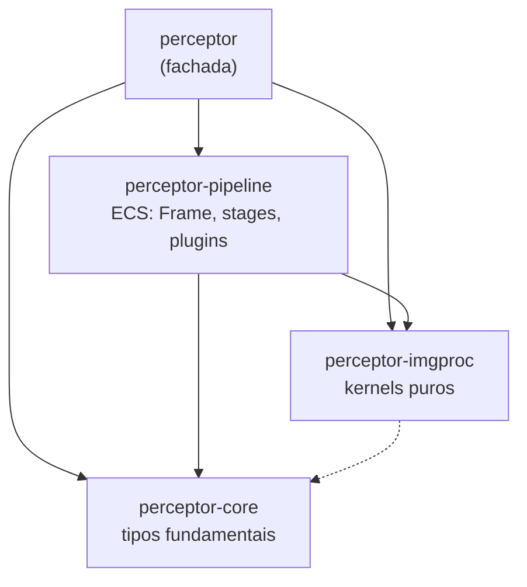
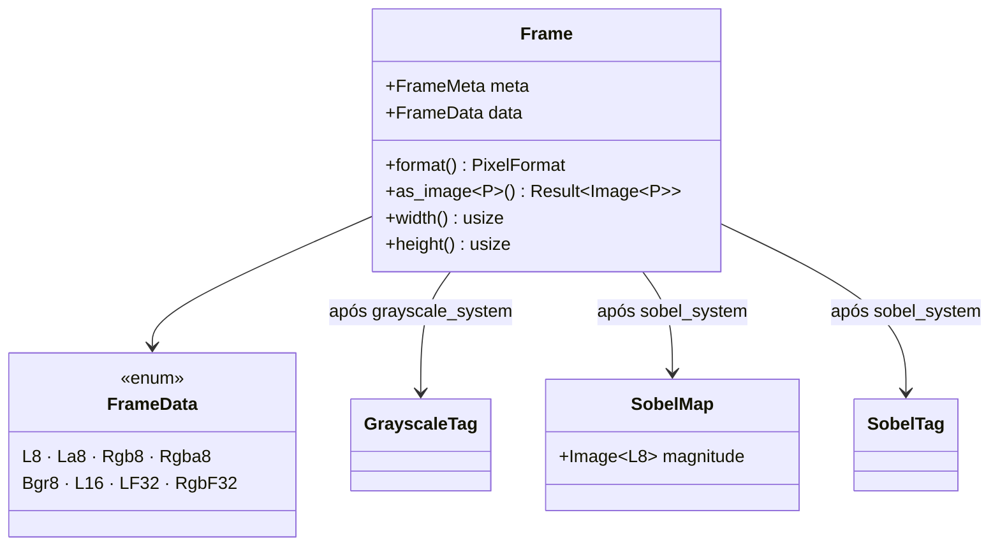

# Arquitetura

## Camadas

O workspace é dividido em crates com dependências em uma única direção:



| Crate | Responsabilidade | Depende de ECS? |
|---|---|---|
| `perceptor-core` | tipos fundamentais (imagem, pixel, erro) — em construção no milestone M1 | não |
| `perceptor-imgproc` | algoritmos como funções puras | não |
| `perceptor-pipeline` | `Frame`, stages, plugins e sistemas que chamam os kernels | sim |
| `perceptor` | fachada que reexporta as camadas e o `prelude` | — |

Crates planejadas (`perceptor-io`, `perceptor-hw`, `perceptor-ml`, `perceptor-gpu`, `perceptor-recipes`) estão descritas no [roadmap](../projeto/roadmap.md).

## Por que separar kernels do ECS

Um kernel que não conhece o `World` pode ser:

- **testado** com uma imagem sintética e um `assert`;
- **medido** em um benchmark sem montar um pipeline;
- **otimizado** (SIMD, paralelismo, GPU) mantendo a versão escalar como referência de corretude.

O sistema ECS correspondente fica reduzido a: consultar frames, chamar o kernel e anexar o resultado.

```rust
// perceptor-imgproc: função pura
pub fn convert_to_gray(input: ImageView<'_, Rgb8>) -> Result<Image<L8>> { /* ... */ }

// perceptor-pipeline: sistema que a orquestra
pub fn grayscale_system(
    mut query: Query<(Entity, &mut Frame), Without<GrayscaleTag>>,
    mut commands: Commands,
) {
    for (entity, mut frame) in &mut query {
        let Ok(rgb) = frame.as_image::<Rgb8>() else { continue };
        let gray = convert_to_gray(rgb.view())?; // o sistema real reporta o erro
        frame.data = gray.into();
        commands.entity(entity).insert(GrayscaleTag);
    }
}
```

## Modelo de dados



### `Frame` e formato de pixel

Um `Frame` carrega uma [`Image<P>`](modelo-de-imagem.md) em qualquer formato. Como uma query ECS não pode ser genérica sobre o formato de cada entidade, o tipo é apagado em `FrameData` (um enum com uma variante por formato) e recuperado no ponto de uso:

```rust
let rgb: &Image<Rgb8> = frame.as_image::<Rgb8>()?;   // Err(FormatMismatch) se não for RGB8
let gray: &mut Image<L8> = frame.as_image_mut::<L8>()?;
frame.data = nova_imagem.into();                      // trocar o formato do frame
```

| Acesso | Formato errado |
|---|---|
| `frame.as_image::<P>()` / `as_image_mut::<P>()` | `Err(Error::FormatMismatch { expected, actual })` |
| `frame.data.into_image::<P>()` | `Err(dados)` — devolve os dados intactos |
| `frame.format()` | — devolve o `PixelFormat` em runtime |

Nenhum desses caminhos entra em pânico, e nenhum converte pixels implicitamente: `Bgr8` não é aceito onde se pede `Rgb8`. Um sistema que só trata um formato ignora os demais com `let Ok(..) = .. else { continue }`, ou reporta o erro em [`PipelineErrors`](pipeline-e-stages.md#tratamento-de-erros).

`FrameMeta` tem `index`, `timestamp` (`Duration` desde o início do stream) e `source` (`Arc<str>`, compartilhado por todos os frames da mesma fonte). `FrameMeta::new(index, source)` cria com timestamp zero.

## Decisões

| Decisão | Motivo |
|---|---|
| `bevy_ecs` como motor | ECS maduro, utilizável sem o restante do Bevy |
| Executor single-thread | sistemas em sequência na thread de `tick()`: spans de stage corretos e latência previsível; o paralelismo fica nos kernels (rayon) |
| Stages fixos como `SystemSet`s de um único schedule | ordem previsível entre leitura, processamento e saída, com ordenação fina dentro do stage |
| `unsafe` confinado | restrito a módulos isolados (SIMD, hardware); `perceptor-core` usa `forbid(unsafe_code)` |
| Referência escalar | toda otimização é validada contra a implementação simples |
