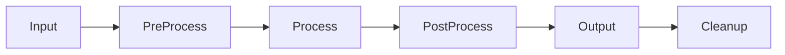

# Pipeline e stages

## Ciclo de um tick

`Pipeline::tick()` roda um único schedule em que cada stage é um `SystemSet`. Os seis sets são encadeados, sempre nesta ordem:



| Stage | Uso |
|---|---|
| `Stage::Input` | fontes criam entidades `Frame` |
| `Stage::PreProcess` | preparação (resize, normalização) |
| `Stage::Process` | filtros e detecção |
| `Stage::PostProcess` | agregação de resultados (NMS, tracking) |
| `Stage::Output` | escrita em disco, exibição |
| `Stage::Cleanup` | remoção das entidades que a saída já consumiu |

`Pipeline::run()` repete ticks até `PipelineState::should_stop` ser `true`.

## Ciclo de vida dos frames

Uma fonte cria um `Frame` por tick. Sem limpeza eles se acumulam no `World` e todo sistema passa a revisitá-los. `despawn_processed_frames_system`, registrado em `Stage::Cleanup`, remove toda entidade com `Frame` depois que os sistemas de saída rodaram.

O `IoPlugin` já o registra. Para inspecionar os frames depois do tick (testes, depuração), use `keep_frames: true`. Um pipeline sem `IoPlugin` não remove nada por conta própria:

```rust
builder.add_cleanup_system(despawn_processed_frames_system);
```

Com a limpeza ligada o frame vive um único tick: tudo o que um sistema precisa ver tem de estar pronto antes de `Stage::Cleanup`, o que a [ordenação](#visibilidade-de-componentes) abaixo garante.

## Controle de parada

```rust
use perceptor::prelude::*;

let mut pipeline = Pipeline::builder().with_max_ticks(3).build();
pipeline.run()?; // executa exatamente 3 ticks
```

`PipelineState` é um recurso ECS com dois campos:

| Campo | Significado |
|---|---|
| `tick_count` | ticks já executados |
| `should_stop` | qualquer sistema pode defini-lo para encerrar o loop |

## Visibilidade de componentes

`Commands` (inserir componente, criar ou remover entidade) são adiados até um **ponto de sincronização**. Há um entre cada par de stages consecutivos e um entre dois sistemas ordenados explicitamente.

| Situação | O segundo sistema vê os `Commands` do primeiro? |
|---|---|
| stages diferentes, mesmo tick | sim |
| mesmo stage, ordenados com `.chain()` / `.before()` / `.after()` | sim |
| mesmo stage, sem ordem | não — só no tick seguinte, e a ordem de execução é indefinida |

```rust
// O Sobel exige o `GrayscaleTag` que o grayscale insere via `Commands`.
builder.add_system(Stage::Process, (grayscale_system, sobel_system).chain());
```

É o que `FiltersPlugin::all()` faz: grayscale e Sobel rodam no mesmo tick.

Sistemas sem ordem entre si podem rodar em paralelo quando não disputam os mesmos dados. Ordene só o que depende de fato.

## Tratamento de erros

Kernels e funções de I/O retornam [`perceptor_core::Result`](../referencia/perceptor-core.mdx). Dentro do pipeline, porém, os sistemas ainda registram a falha em log (`tracing`) e seguem ou sinalizam parada; `tick()` não retorna erro. A propagação de erros com política configurável está planejada em [#40](https://github.com/Bappoz/perceptor/issues/40).
